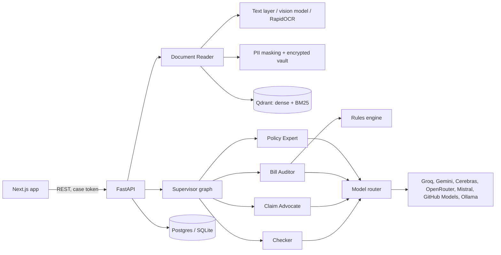

# ClaimSaathi

Health insurance claim checker for India. Upload a policy wording and a hospital bill, and
ClaimSaathi works out, line by line, what the insurer should pay, quoting the policy clause behind
every rupee. If the insurer cut more than the policy allows, it drafts the grievance letter or the
Insurance Ombudsman complaint.

## The problem

Most claim cuts in Indian health insurance come from a handful of rules buried in a 40-page policy:
room rent limits, proportionate deduction of linked charges after a room upgrade, IRDAI's lists of
non-payable items, co-payment, sub-limits and waiting periods. Families find out at discharge, cannot
tell whether a deduction was correct, and rarely know how to contest one.

## Who uses it

| User | What they do with it |
| --- | --- |
| Patients and families | Before admission: what will I pay myself? After discharge: why was ₹18,000 cut? |
| Insurance advisors | Explain a client's deductions in minutes, with clause references |
| Hospital billing and TPA desks | Check a bill against the policy before it is submitted |
| HR teams with group policies | Answer employees' claim questions without escalating to the broker |

## What it does

- **Bill check**: every line marked covered, partly covered or not covered, with the amount and the clause
- **Admission estimate**: expected out-of-pocket cost for a planned treatment and room choice
- **Insurer decision review**: each reason in a rejection or settlement letter checked against the policy
- **Appeal letters**: grievance to the insurer and Ombudsman complaint, citing clauses, edited and approved by the user
- **Policy Q&A**: multi-turn chat that answers only from the policy and cites what it used
- **Document checklist**: what the claim needs, by claim type

## Architecture



### The agents

| Agent | Job |
| --- | --- |
| Supervisor | A LangGraph state machine. Routes each request through the agents it needs; classifies free chat messages; refuses medical advice |
| Document Reader | Reads PDFs and photos, masks personal data, classifies the document, extracts a typed record or indexes the policy |
| Policy Expert | Reads the policy's terms in three focused passes (limits, waiting periods, caps) from retrieved clauses, relates the admission to them, answers questions |
| Bill Auditor | Labels each bill line (IRDAI list first, a fast model for the rest) and hands the arithmetic to the rules engine |
| Claim Advocate | Weighs each insurer reason against the policy; drafts letters from a fixed table of amounts |
| Checker | Rejects invented clause IDs, uncited terms and rupee figures that did not come from the engine, then has a model check that cited clauses support the claim. Failed work goes back to its agent with the issues, up to two retries |

### Design decisions

- **Models never do arithmetic.** They decide what a bill line is and what the policy says; a
  deterministic, unit-tested rules engine computes room-rent excess, proportionate deduction,
  sub-limits, deductible, co-payment and the sum-insured cap with `Decimal`, in the order insurers settle.
- **Every claim is cited.** Policy clauses carry IDs and page numbers from ingestion to the UI, where
  each citation opens the clause text.
- **Free models only, with failover.** Each task (reasoning, fast labelling, vision) has an ordered
  chain of `provider:model` entries read from configuration. Rate limits and repeated failures put a
  model on a cooldown (circuit breaker), transient errors are retried with jittered backoff, an invalid
  answer gets one repair turn, and answers are cached. Providers without a key are skipped; Ollama
  keeps the app working offline.
- **Privacy by default.** Aadhaar, PAN, phone, email, policy and hospital record numbers and patient
  names are replaced with tokens before any text leaves the server. The token map is Fernet-encrypted.
  Original files are processed in memory and never stored, cases expire after 24 hours, and tracing
  sends metadata only.
- **Uploaded documents are untrusted.** Document text is fenced and labelled as data in every prompt,
  so instructions planted in a PDF are not followed.
- **Bounded context.** Clauses are packed best-first within a character budget sized for free-tier
  token limits; chat keeps the last few turns.

## Evaluation

`claimsaathi eval` generates synthetic cases with known answers: a policy wording in the IRDAI layout,
a hospital bill with planted deductions, a discharge summary and, for some cases, an insurer letter
that is either correct or applies a deduction the policy does not allow. Ground truth comes from the
true terms and labels through the tested rules engine, so the evaluation measures the AI steps: reading,
labelling, citing and judging. Chat is scored on multi-turn conversations, including follow-ups and
long answers.

### Latest results

28 synthetic cases across 7 scenarios, run fully offline on a 4 GB laptop GPU with one local model
(`qwen3.5:4b`, 8k context, thinking off). Full report: [backend/evals/report.md](backend/evals/report.md).

| Metric | Result |
| --- | --- |
| Settlement within 2% of the true amount | **93%** (26 of 28; median error 0.0%) |
| Payable / not payable decision | **100%** |
| Policy terms read correctly (room rent, co-pay, waiting period, sub-limit, proportionate clause) | **93–100%** |
| Audits passing the checker | **100%** |
| Appeal or accept recommendation on insurer letters | **100%** |
| Chat answers with the expected fact / follow-up turns / long answers | **82% / 99% / 96%** |
| Chat answers citing a policy clause | **100%** |
| Model calls returning invalid output | **0 of 675** |

Where it is weaker, on this small local model:

- Judging each individual insurer reason scored 50%: the overall appeal/accept call was right every
  time, but the model often marks a partly valid insurer reason as "partly supported" rather than
  "not supported".
- Half the letters failed the checker on the first draft because the model wrote a rupee figure
  that is not in the amount table. The checker caught every one; none reached the user unflagged.
- Letters take about three minutes on a 4 GB GPU. With the hosted free models (Groq, Gemini) every
  step, letters included, runs in well under 30 seconds.

Bill lines are read by a table parser that only accepts a bill whose rows add up to its printed
total, and labelled by keyword rules before any model is asked. The synthetic bills use common
Indian billing terms, so these rules score higher here than they would on unusual real bills,
where the model fallback does more of the work.

## Running locally

Requirements: Python 3.12 with [uv](https://docs.astral.sh/uv/), Node 24, and either free API keys or
[Ollama](https://ollama.com) for local models.

```bash
# API
cd backend
cp .env.example .env            # add keys; generate PII_VAULT_KEY as described in the file
uv sync
uv run alembic upgrade head
uv run claimsaathi routes       # shows which models each task will try
uv run uvicorn app.main:app --reload --port 8000

# Web app
cd frontend
cp .env.example .env.local
npm install
npm run dev                     # http://localhost:3000
```

### Tests and evaluation

```bash
cd backend
uv run ruff check . && uv run mypy app && uv run pytest
uv run claimsaathi eval generate --out ../data/evals --cases 28
uv run claimsaathi eval run --data ../data/evals --report evals
```

## Deployment

- **API**: `backend/Dockerfile`, built by the host (Hugging Face Spaces Docker runtime or any container
  platform). It applies migrations on start and listens on `$PORT`. Use a managed Postgres such as Neon
  for `DATABASE_URL`, and either the embedded Qdrant on local disk or Qdrant Cloud via `QDRANT_URL`.
- **Web app**: any Next.js host such as Vercel, with `NEXT_PUBLIC_API_BASE_URL` pointing at the API.
  Add the web origin to `API_CORS_ORIGINS`.

## Project layout

```
backend/
  app/
    agents/      supervisor graph, policy expert, auditor, advocate, checker
    api/         FastAPI routes, middleware, composition root
    db/          tables and sessions
    documents/   reading, OCR, extraction, PII masking
    evals/       synthetic cases and scoring
    llm/         OpenAI-compatible client, failover router, prompts
    policy/      clause splitting and hybrid search
    rules/       coverage engine, IRDAI item lists, claim checklist
    services/    case lifecycle, uploads, claim runs, read models, telemetry
  migrations/    Alembic
  tests/
frontend/
  src/app/       pages
  src/components/workspace/   case workspace
  src/lib/       API client, types, formatting
```

## Limits

ClaimSaathi explains a policy in its own words; it is not legal or financial advice. Insurers'
wordings vary, and scanned documents of poor quality reduce extraction accuracy. Final decisions rest
with the insurer, its Grievance Redressal Officer and the Insurance Ombudsman.
